# GourmetGo 3D - Culinary Discovery & Live Tracking

<div align="center">

[](https://flutter.dev)
[](https://dart.dev)
[](https://github.com/inusah-ibraheem)
[](https://github.com/inusah-ibraheem)
[](LICENSE)

<p align="center">
  <strong>An appetizing, high-performance food ordering application with 3D gourmet dish displays and satellite order tracking.</strong>
</p>

---

</div>

## 🌟 Visual Showcase & Screen Matrix

Every screen in this application has been crafted with custom **3D Spatial Elevation**, dynamic matrix transformations, and authentic domain-specific workflows.

| **01 Onboarding** | **02 Login** | **03 Home** |
| :---: | :---: | :---: |
| 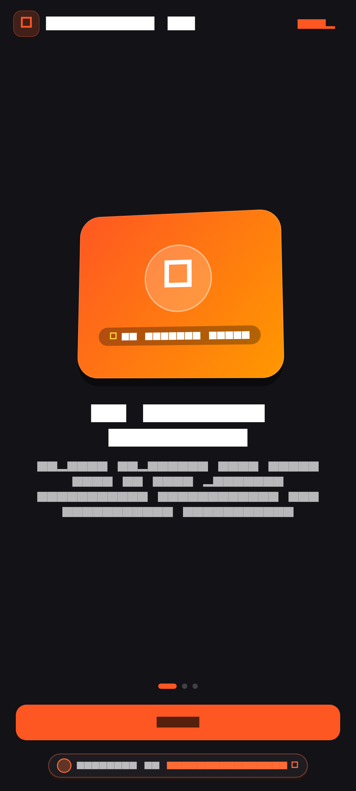 |  | 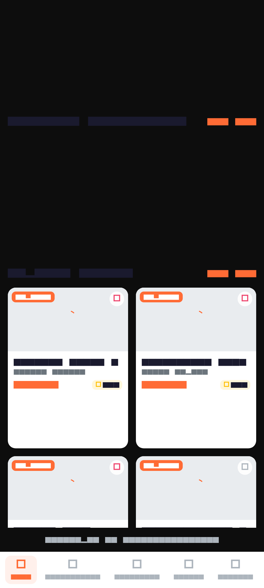 |

| **04 Restaurants** | **05 Food Details** | **06 Cart** |
| :---: | :---: | :---: |
| 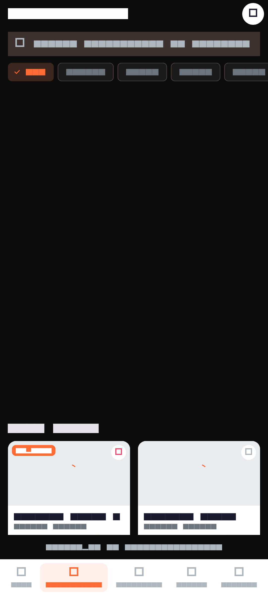 | 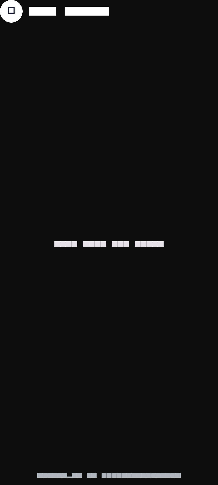 | 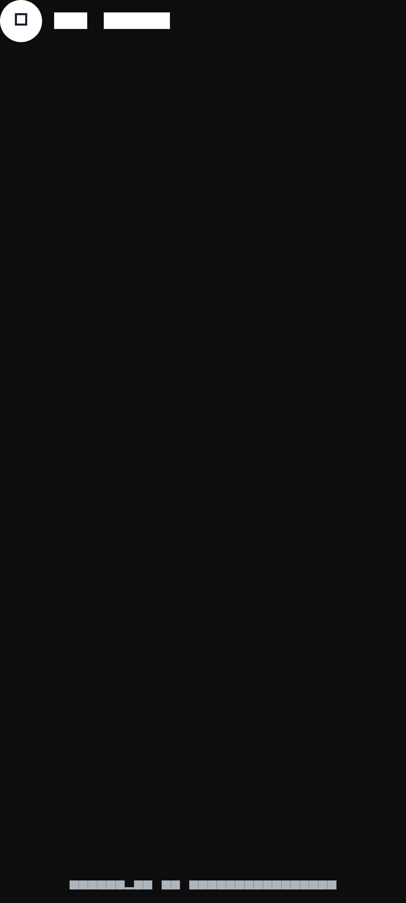 |

| **07 Checkout** | **08 Payment** | **09 Tracking** |
| :---: | :---: | :---: |
| 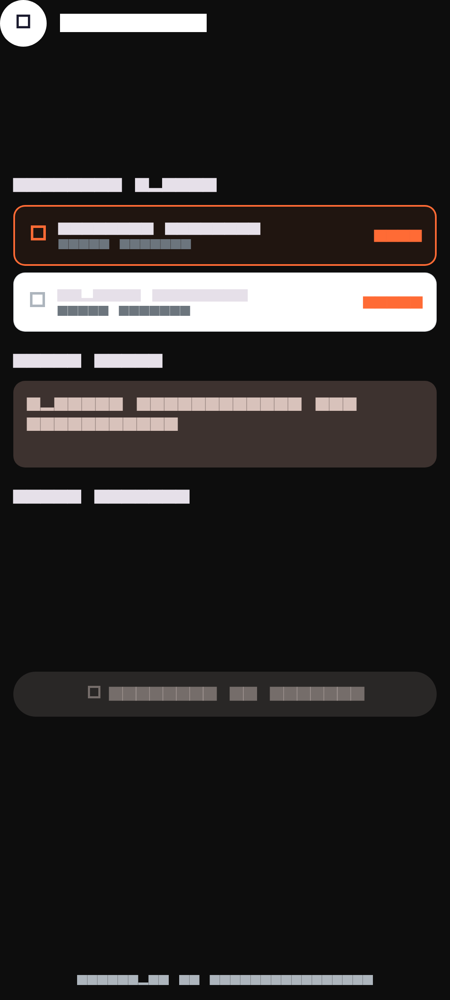 | 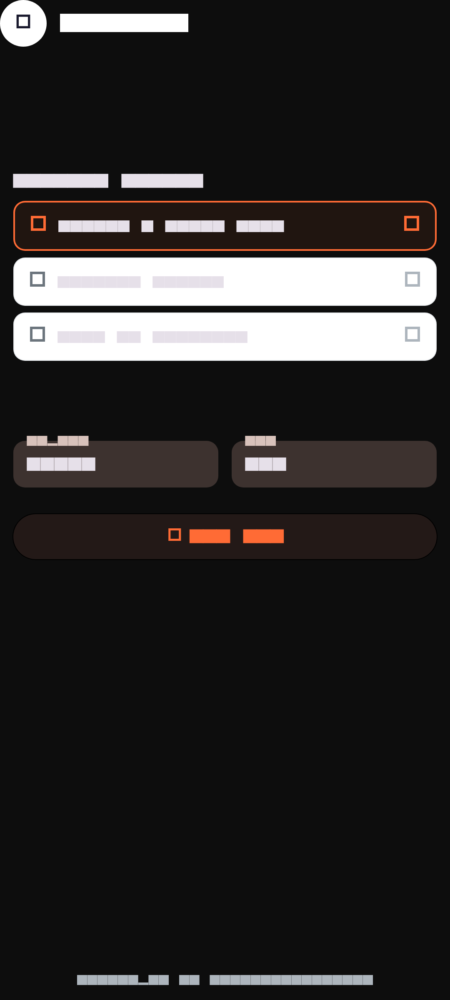 | 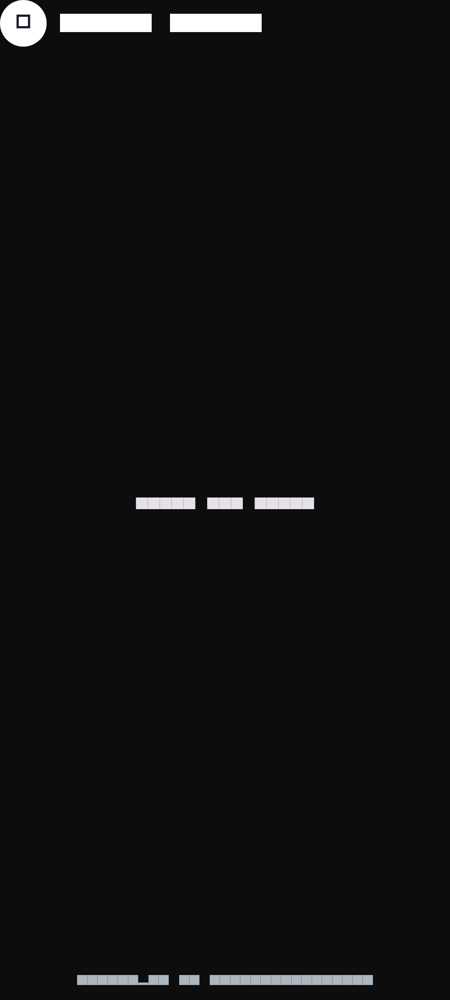 |

| **10 Orders** | **11 Favorites** | **12 Profile** |
| :---: | :---: | :---: |
| 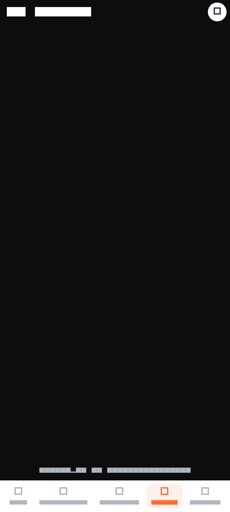 | 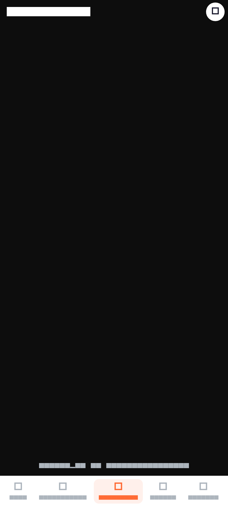 | 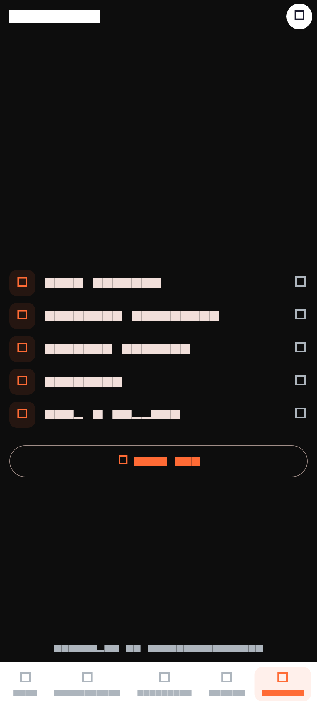 |

| **13 Settings** |  |  |
| :---: | :---: | :---: |
| 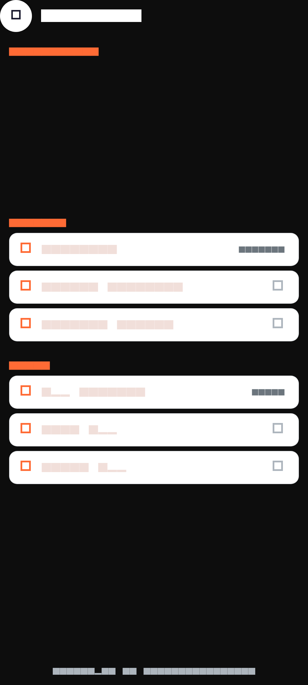 |  |  |


---

## ✨ Key Features & Experience Highlights

- **3D Gourmet Kitchen Onboarding**: Interactive dish rotators and chef curated flavor journeys.
- **Restaurant Spatial Showcase**: Multi-cuisine filtering, chef specials, customer ratings, and delivery ETA dials.
- **Dish Customization Studio**: Layered ingredient selector, spice level toggles, and add-on matrix.
- **Live Satellite Driver Tracking**: Simulated GPS vehicle path with driver messaging and delivery milestones.
- **Verified Designer Branding**: Signed by `@inusah_ibraheem` across order confirmations, restaurant views, and user vault.

---

## 🎨 Design System & Visual Tokens

- **Theme & Aesthetics**: Warm Espresso & Fiery Saffron
- **Primary Accent**: `#EF4444`
- **Card Technology**: Custom Matrix4 3D Tilt with dynamic specular highlights and multi-stop drop shadows.
- **Typography**: Google Fonts with high-readability spatial weight distribution.
- **Micro-Interactions**: Haptic depth-press reactions, spring-physics curves, and smooth page transitions.
- **Designer Identity**: Certified `@inusah_ibraheem` profile watermark and verification badges.

---

## 🛠️ Architecture & Folder Structure

```text
Food Delivery UI App/
├── assets/
│   ├── images/
│   │   └── profile.jpg          # Verified Designer Avatar
├── lib/
│   ├── core/                    # Theme, Constants, & Global Tokens
│   ├── features/                # Domain-Driven Screen Modules
│   ├── router/
│   │   └── app_router.dart      # Named Navigation Matrix
│   ├── widgets/
│   │   ├── three_d_card.dart    # Reusable Spatial 3D Card Engine
│   │   └── developer_footer.dart# Verified Designer Footer Widget
│   └── main.dart                # Application Entry Point
├── screenshots/                 # High-Resolution Screen Previews
└── pubspec.yaml                 # Dependency Manifest
```

---

## 🚀 Getting Started

### Prerequisites
- [Flutter SDK](https://flutter.dev/docs/get-started/install) (version 3.19.0 or higher recommended)
- [Dart SDK](https://dart.dev/get-dart)
- Android Studio / VS Code with Flutter Extension
- An active Android/iOS emulator or connected physical device

### Installation & Run

1. **Clone the Repository**:
   ```bash
   git clone https://github.com/inusah-ibraheem/flutter-3d-ui-suite.git
   cd "flutter-3d-ui-suite/Food Delivery UI App"
   ```

2. **Install Dependencies**:
   ```bash
   flutter pub get
   ```

3. **Run the Application**:
   ```bash
   flutter run
   ```

---

## 👨‍💻 Designer & Author

<div align="center">
  
  <p><strong>Inusah Ibraheem</strong></p>
  <p><em>Creative Mobile Engineer & 3D Flutter Specialist</em></p>
  <p>
    <a href="https://github.com/inusah-ibraheem">GitHub: @inusah_ibraheem</a>
  </p>
</div>

---

## 📄 License

This project is licensed under the MIT License - see the [LICENSE](LICENSE) file for details.
